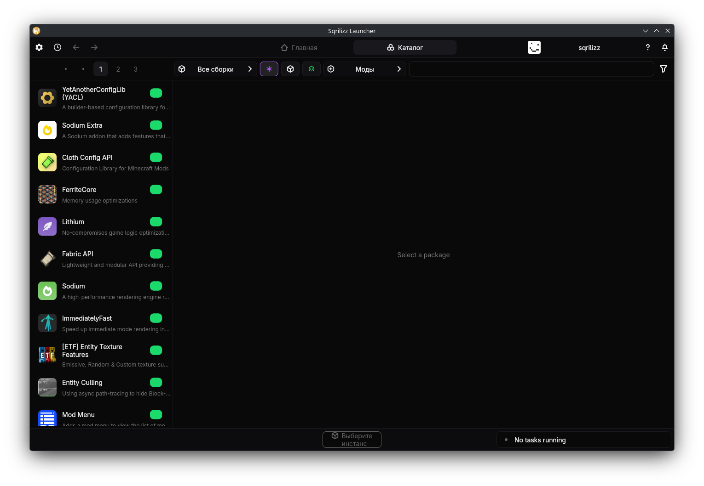
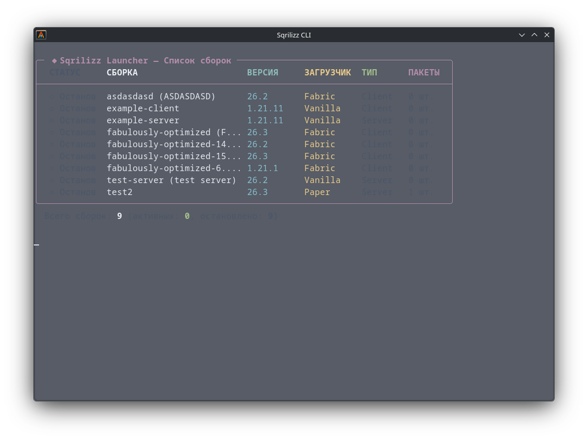
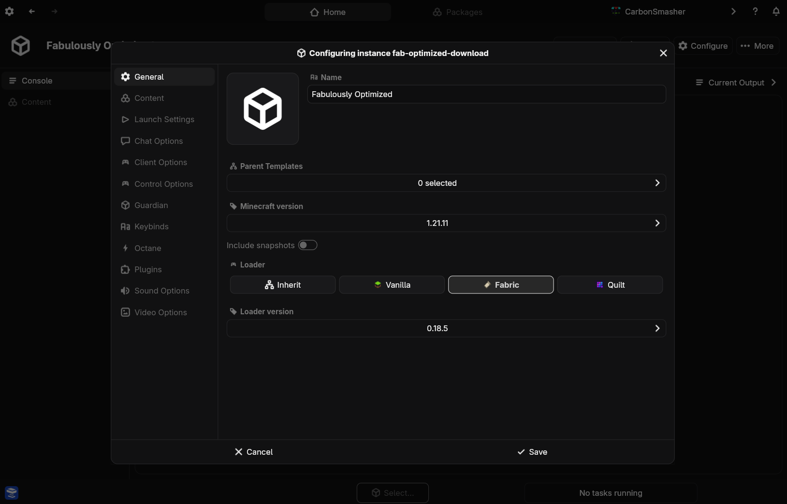
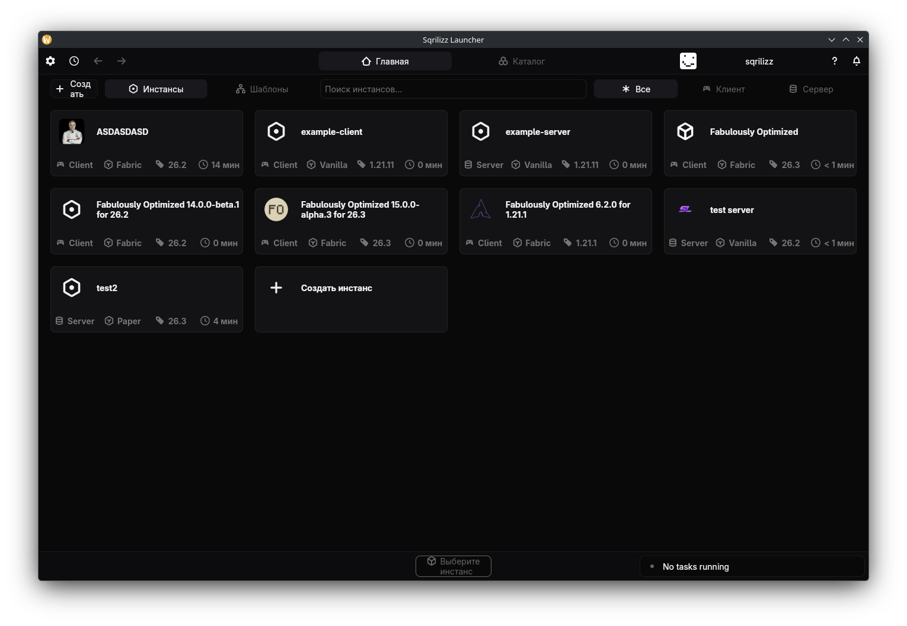

  

<h1 align="center">Sqrilizz Launcher</h1>

  <strong>The supercharged, modular Minecraft launcher & ecosystem</strong>

  
  
  
  

---

Sqrilizz is a modern, blazing-fast Minecraft launcher, server manager, and ecosystem engineered in Rust.

The architecture is fully modular, letting you configure exactly the features you need for your setup. It's built for players, developers, and server administrators alike.

- 🌐 [Official Website](https://sqrilizz.tech)
- 📖 [Documentation](https://github.com/Sqrilizz/SqrilizzLauncher/tree/main/docs)

# Features

## Native Desktop & Lightning-Fast CLI

Sqrilizz adapts to your workflow: run it as a rich native desktop application or as a lightweight, scriptable command-line interface.

| Desktop GUI | Modern CLI |
| :---: | :---: |
|  |  |

## In-App Auto-Updates

Never manually download updates again. Sqrilizz checks for new releases on launch and updates itself in-place with a single click.

## Modular Configuration & Instance Templates

Share configuration between instances using instance templates. Perfect for syncing modpacks and server configs across devices.

## Play with Friends & Server Management

Sqrilizz natively supports both game clients and servers. Export templates with one-click codes to instantly synchronize your setup with friends.

## Modern Package Management

Seamlessly install mods, datapacks, resource packs, shaders, and modpacks from Modrinth, Smithed, and more. Customize modpacks while maintaining clean upgrade paths.

## And Much More!

- **Zero-Friction Migration**: Switch from your current launcher without copying files.
- **Enhanced Datapack Support**: Global datapack management and pack welding.
- **Cross-Instance Sharing**: Backwards-compatible options and settings sharing.
- **Server Administrator Toolkit**: Automated backups, multi-instance orchestration, and resource monitoring.

---

# 🚀 Getting Started

Check out the [User Guide & Documentation](https://github.com/Sqrilizz/SqrilizzLauncher/tree/main/docs) to install and configure Sqrilizz.
