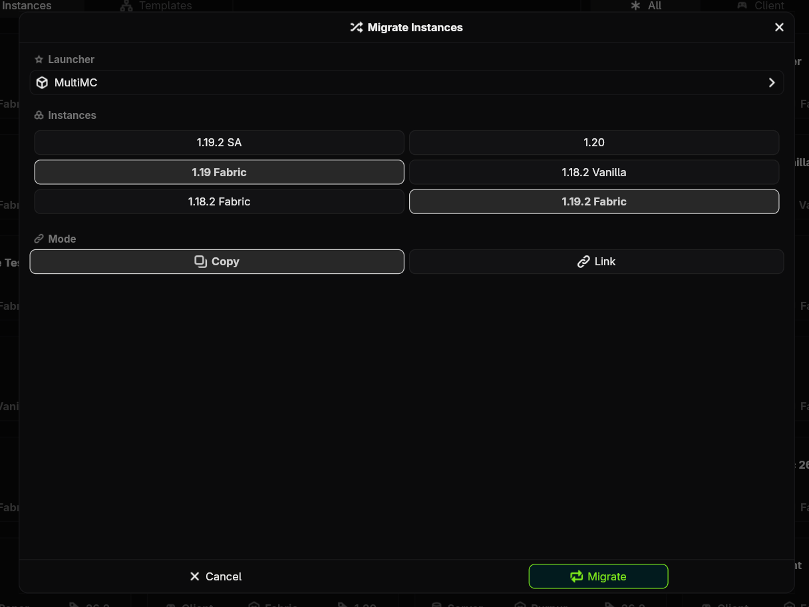
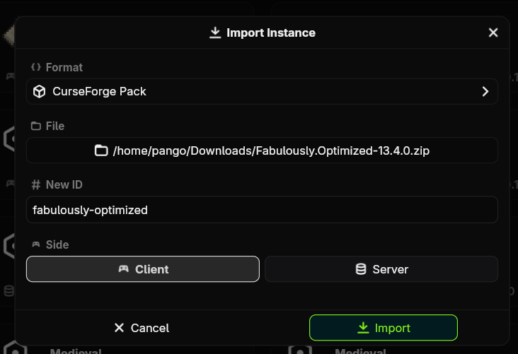
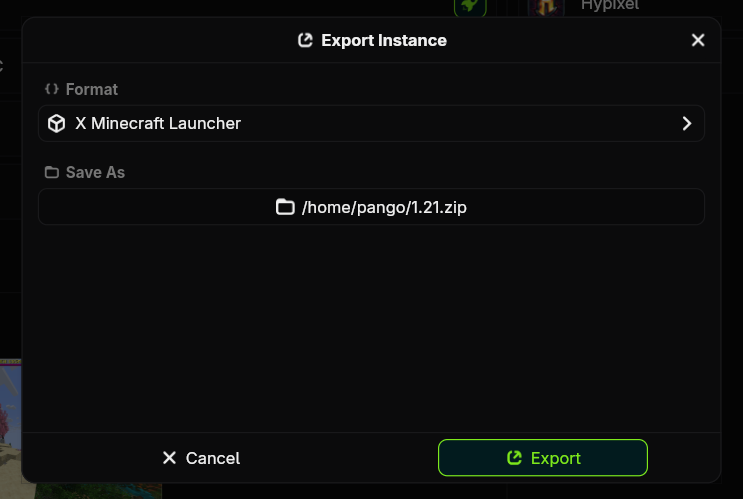

# Importing and Exporting

Sqrilizz has a dedicated system for importing, exporting, and migrating from other launchers and formats out of the box. MultiMC, PrismLauncher, XMinecraftLauncher, Mojang Launcher, Modrinth, and CurseForge formats are supported natively.

## Migrating

If you are coming from another launcher, there is no need to export each file manually. Sqrilizz can find the launcher on your computer and import all of the instances with no extra steps.

+++ App
On the home page, click the `+ New` button in the top left, and select `Migrate Instances`.

Select the launcher to migrate from, and Sqrilizz will scan it to find what instances it has. Select any instances you want to import, or select none of them to import all instances.

+++ CLI
Run the `sqrilizz migrate` command to start migrating and follow the prompts.
+++

### Copy vs Link
- Copy: Copy every single file from the instances to create totally new ones. Changes made to your Sqrilizz instances will not affect the original ones.
- Link: Run the Sqrilizz instances using the original instance directories. Changes made to your Sqrilizz instances, like save data or settings, will affect the original instances.

## Importing

+++ App
On the home page, click the `+ New` button in the top left, and select `Import Instance`.

Select the format you are importing in, the file you want to import, and an ID for the new instance. Then select a side if it is needed and click `Import`.

+++ CLI
Use the `sqrilizz instance import <path/to/file>` command and follow the prompts to import the new instance.
+++

## Exporting

+++ App
On the instance page, click the `More` button and select the `Export` option. Select the format and the path for the output file, then click `Export`.

+++ CLI
Use the `sqrilizz instance export <path/to/new/file>` command and follow the prompts.
+++
