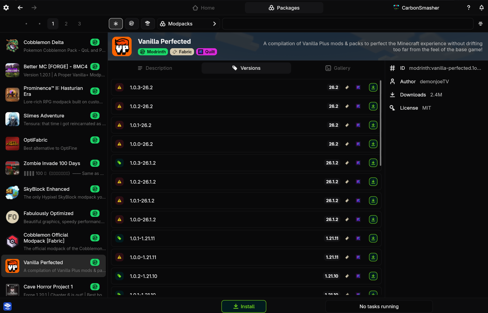
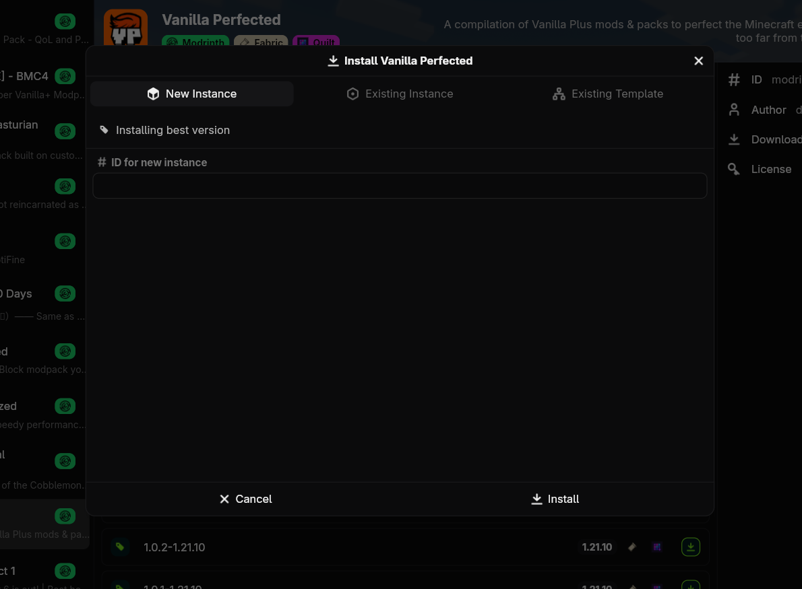

# Modpacks

Modpacks in Sqrilizz are implemented as special packages you can add to instances and templates. If you haven't already read the [packages guide](packages/index.md), you should do that first.

Sqrilizz natively supports both Modrinth (`.mrpack`) and CurseForge modpack formats out of the box.

## Finding Modpacks

Modpacks are simply another package type you can search in the package browser.

## Installing

There are two ways that modpacks can be installed:
1. On a new instance
2. On an existing instance or template

+++ App
Find the modpack and click install at the bottom of the screen to install the latest version. If you want to install the modpack for a different Minecraft version, you must click the install button on one of the versions in the versions tab. Then follow the prompts to install.

+++ CLI
Find the modpack you want in the package browser and press `i` to install the latest version. If you want to install the modpack for a different Minecraft version, you must press `i` on one of the versions in the versions tab. Then follow the prompts to install.
+++

!!!info Note
When adding to an existing instance that you have already played, the modpack will be unable to overwrite any files you already have, so it can result in game options and mod configs not being updated. It is usually better to install on a new instance.
!!!

## Updating

Unlike other parts of an instance, the modpack will NOT be updated when doing a normal instance update, unless the modpack has never been installed.

+++ App
Navigate to the instance's content config on its page. Locate the modpack at the top and click the cycle button to update it. This may take some time.

+++ CLI
Run `sqrilizz instance update --modpack <instance>`. This may take some time.
+++

## Adding Packages

Unlike other launchers, Sqrilizz lets you add your own packages on top of a modpack. The installed modpack will automatically suppress packages that it adds, meaning your packages won't duplicate any dependencies.

Simply install the packages like you would normally.

!!!info Note
Updating an instance's packages will **not** update the modpack, but updating the modpack will update the packages.
!!!
