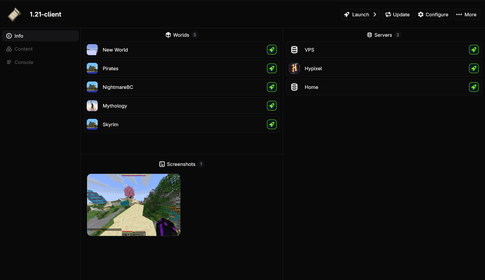

# Updating Instances

Updating an instance will upgrade all of its versions, packages, and files. It should be done whenever you want to use newer versions or when you change an instance's configuration.

+++ App
Go to the instance's page by double clicking it on the homepage or selecting it and clicking more options at the bottom. Then click the `Update` button in the top right.

+++ CLI
Run `sqrilizz instance update <instance>` to start the update.
+++

## Forced Updates
Sometimes, files might get corrupted if there is a network interruption or you cancel an operation in the middle. To fix this, you can run a forced update, which will redownload all managed files for an instance (preserving your saves and personal data).

+++ App
Not implemented yet.
+++ CLI
Run `sqrilizz instance update --force <instance>`
+++
